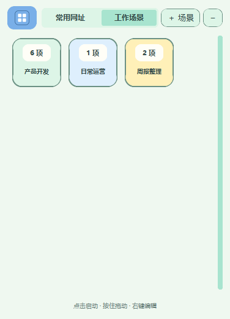

# 网址盒 · Windows 工作场景版

## 打开和原版保留

解压工作场景版的 ZIP，再双击 `FloatingLinkDockScenes.exe`。它用蓝色四宫格图标和微软雅黑界面。绿色笑脸的常用网址版是另一个应用，可以同时打开。

如果正在使用较早的场景版，请先在它的托盘菜单选择“退出”，再打开新版。原网址盒不用退出。各个场景版沿用同一个场景数据目录，已有场景和入口无需重新导入。

第一次打开时，如果检测到原网址，会询问是否导入。选“是”会复制原网址和方块位置到“常用网址”场景，不修改原数据；选“否”从空场景开始。两个版本后续的数据互不自动同步。

## 顶部两个选项

- **常用网址**：每个方块是一个入口，点击打开。点击“＋ 添加”增加入口。
- **工作场景**：每个方块是一个场景，方块上的数字表示可一起打开的项目数。左键点方块一键打开，按住拖动可自由摆放，松手后自动保存位置。右键选“编辑场景”调整项目。

切换顶部选项不打开任何项目。常用入口与工作场景各自保存资源和方块布局。

## 建立工作场景

1. 切到“工作场景”，点击右上角“＋ 场景”，输入名称。
2. 在场景编辑页点「＋ 添加」，保存网址、路径、应用或常用文字。飞书多维表和云文档选「网址」，粘贴链接即可。
3. 点「返回」，以后左键点击场景方块，就能一起打开其中的网址、文件、文件夹和应用。

右键场景方块，可以直接编辑、重命名或删除该场景。删除前会弹出确认，只移除网址盒里的入口。要复制场景，可以进入编辑页，点「管理」。

## 添加项目

点“＋ 添加”，选择类型，填写名称与目标，点“保存”。

| 类型 | 填什么 | 点击方块 |
|---|---|---|
| 网址 | 网站地址 | 用默认浏览器打开；右键可选择浏览器，仅对本次生效 |
| 文件 / 文件夹 | 本地或 NAS 的完整路径 | 自动识别。文件用关联的软件打开，文件夹在资源管理器中打开 |
| 应用 | 点「选择应用」，选盘符下的 `.exe` 程序或 `.lnk` 快捷方式，也可粘贴完整路径 | 启动程序或打开快捷方式 |
| 常用文字 | 需要反复复制的内容，可换行 | 复制到剪贴板 |

选「文件 / 文件夹」后，可粘贴完整路径，也可点「选择文件」或「选择文件夹」浏览。支持 NAS 路径，例如 `\\NAS\共享目录\成本表.xlsx`，也支持已连接的盘符，例如 `Z:\资料`。程序在打开时检查路径，保存入口时可以暂时断开 NAS。

「文件 / 文件夹」支持 PDF、Excel、Word、PowerPoint、txt、csv、常见图片、psd 和 ai 等文档。程序和桌面快捷方式请选择「应用」。

项目方块上的「网」「路径」「应用」「字」表示类型。右键项目方块可以编辑或删除，按住拖动可调整位置。

## 一键启动

左键点击场景方块，场景里的网址、文件、文件夹和应用会一起启动。要单独启动应用，可以点「常用网址」里的应用方块，也可以右键场景方块进入编辑页，再点击应用方块。常用文字留在编辑页，单独点击复制。

打开结果显示在窗口底部，有失败或超时会显示项目详情。“已发出打开请求”表示已交给系统处理；飞书、NAS 等仍使用你已有的登录和访问权限。

网络请求约10秒未完成会提示超时。**超时不等于已取消发出的系统请求**，它仍可能稍后打开；未执行的排队项目会停止。先检查连接，避免立即重复点击。工作者都被占用时，可稍后重试或退出场景版重开。

## NAS打不开怎么办

先在资源管理器中打开同一个路径，确认VPN/局域网、共享连接和权限正常。检查文件有没有移动、盘符是否变化、电脑是否安装了能打开该文件的软件。恢复连接后再重试，或右键方块修改路径。

## 悬浮窗与退出

点击蓝色四宫格或减号收起，再点蓝色悬浮按钮展开。按住页签上方的空白区或蓝色图标拖动，可以移动整个窗口。右键标题区或悬浮按钮可设置置顶、贴边半隐藏、开机启动或重置位置。场景版开机启动默认关闭，只有你主动勾选才启用，不修改原版启动项。若此前指向旧场景版程序，可在新图标版中重新勾选开机启动，将场景版入口改为新位置。

蓝色四宫格托盘图标的菜单中选择“显示工作场景”找回窗口，选择“退出”完全关闭。托盘入口不会显示在任务栏。

## 数据备份和切回原版

- 场景版：`%LOCALAPPDATA%\FloatingLinkDockScenes`，`scenes.json`保存场景和设置。
- 第一次保存应用入口时，会把此前的场景数据备份为 `backups\before-app-entries.json`。旧场景版无法读取含有应用入口的配置。
- 原版：`%LOCALAPPDATA%\FloatingLinkDock`，保留原来的网址和布局。

备份自己的场景时先退出，再复制场景版整个数据文件夹。`backups`中有损坏文件备份，`errors.log`是错误日志；这些可能含个人路径或内容，不要直接公开。

使用常用网址版时，双击 `FloatingLinkDock.exe`。两款应用分别读取各自的数据。
